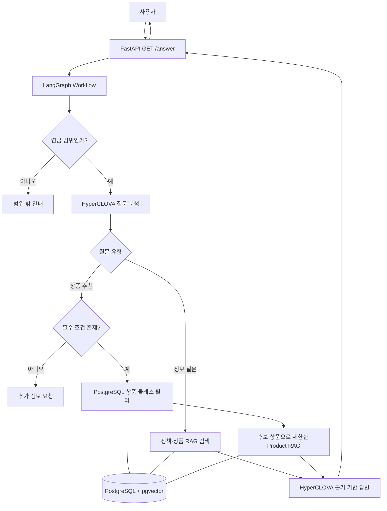

# 연금 RAG 상담 API 기술설명서

## 1. 프로젝트 개요

이 프로젝트는 연금 제도·규정 문서와 연금 상품 데이터를 근거로 질의응답 및 상품 후보 추천을 제공하는 AI 연금 상담 API의 MVP다. 사용자가 IRP, 연금저축, 퇴직연금, 세제, 중도인출 등의 질문을 보내면 질문의 성격을 분석하고, 필요한 데이터만 검색한 뒤 HyperCLOVA X가 검색 근거를 바탕으로 답변을 생성한다.

핵심 설계 원칙은 다음과 같다.

> 자연어 이해와 설명은 LLM이 담당하고, 정확한 상품 조건 필터링은 DB가 담당하며, 답변 근거는 RAG 검색 결과로 제한한다.

이 문서는 현재 저장소의 실제 구현을 기준으로 한다. 장기 목표인 세션 복원, 완전한 Input/Output Guard, 별도 Rule Engine, 다중 API 라우트 등은 현재 MVP의 구현 범위에 포함되지 않는다.

## 2. 해결하려는 문제

연금 상담 질문은 제도 설명, 상품 속성, 개인의 계좌 유형·위험 선호처럼 서로 성격이 다른 정보를 함께 다룬다. 단순 생성형 챗봇은 근거 없는 규정이나 상품 특성을 말할 위험이 있다.

이 서비스는 이를 다음과 같이 분리한다.

| 구분 | 처리 방식 | 목적 |
| --- | --- | --- |
| 연금 제도·규정 설명 | 정책 RAG 검색 | 원문 근거를 가진 설명 제공 |
| 상품 설명 | 상품 RAG 검색 | 후보 상품의 문서 근거 확보 |
| 계좌 유형·위험 선호 등 명확한 조건 | PostgreSQL 필터 | 상품 후보를 결정론적으로 축소 |
| 질문 분석과 최종 답변 | HyperCLOVA X | 자연스러운 질의 이해와 근거 기반 설명 |

## 3. 제공 기능

### 3.1 연금 정보 질의응답

사용자는 `IRP가 무엇인지 알려줘`처럼 제도나 규정에 관한 질문을 보낼 수 있다. 서비스는 질문을 연금 관련 정보 질문으로 분류하고, 정책 또는 상품 RAG 데이터에서 유사한 청크를 검색하여 답변 근거로 사용한다.

### 3.2 조건 기반 상품 후보 추천

상품 추천은 계좌 유형과 투자 위험 선호를 최소 입력 조건으로 사용한다. 두 조건 중 하나라도 빠지면 후보 검색 전에 추가 정보를 요청한다. 조건이 갖춰지면 판매 중인 상품 클래스만 DB에서 필터링하고, 해당 후보에 한해서 상품 RAG 근거를 검색한다.

### 3.3 범위 밖 질문 제한

질문에 연금 도메인 용어가 전혀 없으면 외부 LLM·RAG 호출 전에 연금 상담 범위 밖으로 처리한다. 이후 LLM 분석에서도 연금과 무관하다고 판정되면 같은 방식으로 종료한다.

### 3.4 출처와 처리 요약 제공

`/answer` 응답에는 문서 식별자와 페이지로 구성된 `retrieved_context`, 그리고 실제 분류·검색 결과를 한 줄로 요약한 `think_trace`가 포함된다. 이는 모델의 내부 추론을 노출하는 값이 아니라, 서비스가 수행한 검색 절차의 요약이다.

## 4. 시스템 아키텍처



### 구성 요소별 역할

| 구성 요소 | 역할 |
| --- | --- |
| FastAPI | HTTP 요청 검증, 워크플로 실행, 표준 JSON 응답 생성 |
| LangGraph | 범위 확인, 질문 분석, 추천 조건 확인, 검색, 답변 생성을 순서대로 연결 |
| HyperCLOVA X | 질문 유형·사용자 조건·보조 검색어 추출 및 최종 답변 생성 |
| PostgreSQL | 상품 클래스의 정형 속성 저장 및 조건 필터링 |
| pgvector | 정책·상품 RAG 청크의 1,024차원 임베딩 코사인 유사도 검색 |
| Docker Compose | API, PostgreSQL/pgvector, 초기 데이터 적재 작업을 컨테이너로 실행 |

## 5. 요청 처리 흐름

1. FastAPI가 `question_id`와 `question`을 검증한다. 질문 길이는 1~1,000자로 제한한다.
2. 키워드 기반 1차 범위 확인을 수행한다. 연금과 무관하면 즉시 안내 응답을 반환한다.
3. HyperCLOVA X가 연금 관련성, 질문 유형(`PENSION_INFO` 또는 `PENSION_RECOMMENDATION`), 사용자 조건, 검색 대상, 보조 검색어를 JSON으로 반환한다.
4. Pydantic 스키마가 LLM 응답을 검증한다. 형식 오류가 나면 설정된 횟수만큼 JSON 형식 교정을 재시도한다.
5. 정보 질문은 선택된 정책/상품 RAG를 검색한다. 원문 질문에 보조 검색어 최대 2개를 더해 검색할 수 있다.
6. 추천 질문은 계좌 유형과 위험 선호가 있는지 확인한다. 부족하면 `NEED_MORE_INFO`로 종료한다.
7. 조건이 충분하면 DB에서 판매 상태, 가입 가능 계좌, 위험 등급, 선택적인 판매 채널로 상품 클래스를 필터링한다.
8. 후보 상품별 RAG 근거를 검색하고 점수화하여 최종 후보를 정한 뒤, 검색 근거와 함께 HyperCLOVA X에 전달한다.
9. 근거 청크가 없으면 답변 생성을 하지 않고 `NO_GROUNDED_CONTEXT` 안내를 반환한다.

## 6. 상품 추천 로직

### 6.1 필요한 사용자 조건

현재 구현에서 상품 후보를 DB로 필터링하기 위한 필수 조건은 다음 두 가지다.

| 조건 | 값 예시 | 사용 목적 |
| --- | --- | --- |
| 계좌 유형 | `IRP`, `PENSION_SAVINGS`, `RETIREMENT_PENSION` | 해당 계좌에서 가입 가능한 클래스만 선택 |
| 위험 선호 | `CONSERVATIVE`, `BALANCED`, `AGGRESSIVE` | 위험 등급 범위를 정해 후보 축소 |

위험 선호는 상품 위험 등급으로 다음과 같이 변환한다. 숫자 1이 가장 높은 위험, 6이 가장 낮은 위험이다.

| 사용자 위험 선호 | 검색 위험 등급 |
| --- | --- |
| 안정형 | 5~6등급 |
| 균형형 | 3~4등급 |
| 공격형 | 1~3등급 |

판매 채널은 질문에서 추출됐을 때만 추가 필터로 사용한다.

### 6.2 후보 수와 근거 수 제한

후보 DB 조회는 조건에 맞는 상품 클래스를 정렬해 가져온 후, 중복 상품을 제거하여 최대 20개의 고유 상품을 선택한다. 정렬 우선순위는 위험 등급 내림차순, 총보수 오름차순, 상품명 및 클래스명 순이다.

그 다음 각 후보 상품에 대해 RAG 근거 청크를 최대 2개까지 검색한다. 최종 추천은 근거 청크 유사도 점수를 기준으로 최대 5개 상품만 선택한다. 따라서 최종 LLM에 전달되는 상품 근거는 최대 10개 청크다.

| 단계 | 최대 수 | 설명 |
| --- | ---: | --- |
| 고유 상품 후보 | 20개 | DB 필터 결과에서 중복 상품 제거 후 제한 |
| 후보별 근거 | 2개 | 상품별 RAG 청크 제한 |
| 최종 추천 | 5개 | 근거 점수 상위 상품 |
| 최종 상품 근거 | 10개 | 최종 추천 5개 × 상품별 최대 2개 |

검색은 원문 질문과 보조 검색어 최대 2개, 총 최대 3개 질의로 수행한다. 같은 청크가 여러 검색어에 노출될 경우 최고 유사도 점수 하나만 유지한다.

## 7. 데이터 모델과 RAG 구조

### 7.1 `product_classes`

`product_classes`는 실제 가입 단위인 상품 클래스를 저장한다. 한 행에는 상품 및 클래스 이름, 위험 등급, 자산 유형, 가입 가능 계좌, 판매 채널, 보수, 판매 상태, 원본 페이지 등이 저장된다.

상품 추천 필터는 이 테이블에서 수행한다. `eligible_account_types`는 PostgreSQL 배열이며, 계좌 유형 검색을 위해 GIN 인덱스를 사용한다.

### 7.2 `rag_chunks`

`rag_chunks`는 정책과 상품 설명을 검색 가능한 청크로 저장한다.

| 필드 | 용도 |
| --- | --- |
| `knowledge_type` | `POLICY` 또는 `PRODUCT` 구분 |
| `product_id` | 상품 RAG 청크를 상품 후보와 연결 |
| `document_id`, `document_title` | 원문 문서 식별 |
| `section_id`, `section_title`, `topic` | 문서 내 의미 단위 식별 |
| `content`, `page_start`, `page_end` | 답변 근거 및 페이지 출처 |
| `embedding` | 1,024차원 벡터, 코사인 유사도 검색에 사용 |
| `validation_status`, `metadata` | 검수 상태와 확장 메타데이터 보존 |

`POLICY` 청크에는 `product_id`를 넣지 않고, `PRODUCT` 청크에는 반드시 `product_id`를 둬 검색 시 상품 후보 목록으로 제한할 수 있게 한다.

### 7.3 검색 방식

질문은 CLOVA 임베딩 API로 벡터화된다. PostgreSQL은 pgvector의 코사인 거리 연산자를 사용해 유사도 점수를 계산하며, HNSW 인덱스로 벡터 검색을 지원한다.

정보 질문은 기본적으로 상위 5개 청크를 응답 근거로 사용한다. 추천 질문은 후보 상품 ID로 먼저 범위를 제한한 다음 상품별 최대 2개 청크를 유지한다.

## 8. LLM 연동과 검증

HyperCLOVA X는 두 단계에서 사용된다.

1. **질문 분석**: 도메인 관련성, 의도, 검색 대상, 보조 검색어, 명시된 사용자 조건을 JSON으로 추출한다.
2. **답변 생성**: 질문 분석 결과, 필터된 상품 후보, 검색 청크의 원문을 입력으로 받아 JSON 형태의 답변을 생성한다.

모델 출력은 Pydantic 모델(`QueryAnalysis`, `RagAnswer`)로 검증한다. JSON 구문이나 스키마가 맞지 않으면 직전 응답을 포함해 형식 교정 요청을 재시도한다. 답변 생성은 검색된 근거가 있을 때만 실행된다.

모델 호출에는 system/user 역할을 분리해 전달하고, API 키는 환경변수에서만 읽는다.

## 9. API 명세

### `GET /health`

컨테이너가 HTTP 요청을 받을 수 있는지를 확인한다.

응답 예시:

```json
{"status":"ok"}
```

### `GET /answer`

질문을 분석·검색·답변 생성하여 반환한다.

| 쿼리 파라미터 | 타입 | 제약 | 설명 |
| --- | --- | --- | --- |
| `question_id` | 문자열 | 1~128자 | 호출자가 지정하는 질문 식별자 |
| `question` | 문자열 | 1~1,000자 | 사용자의 연금 질문 |

요청 예시:

```bash
curl -G "http://localhost/answer" \
  --data-urlencode "question_id=test-001" \
  --data-urlencode "question=IRP가 무엇인지 알려줘"
```

응답 예시:

```json
{
  "question_id": "test-001",
  "question": "IRP가 무엇인지 알려줘",
  "retrieved_context": [
    {"document_id": "DOC_014", "page": 2},
    {"document_id": "DOC_014", "page": 1}
  ],
  "think_trace": "연금 정보 질문으로 분류 → POLICY_RAG 문서 2건 검색 → 근거 기반 답변 생성",
  "answer": "IRP는 개인형퇴직연금 제도입니다. ..."
}
```

처리 중 외부 API나 DB 오류가 발생하면 HTTP 503과 사용자 안내 메시지를 반환한다.

## 10. 배포 구조

Docker Compose는 세 서비스를 정의한다.

| 서비스 | 이미지/빌드 | 역할 |
| --- | --- | --- |
| `app` | 프로젝트 `Dockerfile` | Uvicorn으로 FastAPI 실행, 호스트 80 포트를 컨테이너 8000 포트에 연결 |
| `postgres` | `pgvector/pgvector:0.8.6-pg17-bookworm` | PostgreSQL과 pgvector 제공, 초기 스키마 실행 |
| `seed` | 프로젝트 `Dockerfile` | profile 기반 일회성 데이터 적재 작업 |

API 컨테이너는 PostgreSQL health check가 통과한 뒤 시작한다. 데이터베이스 데이터는 named volume(`pension_postgres_data`)에 보존한다. API 키와 DB 비밀번호는 `.env`를 통해 주입하며 이미지에 포함하지 않는다.

초기 실행은 아래 순서다.

```bash
docker compose -p pension-agent up -d postgres
docker compose -p pension-agent --profile seed run --rm seed
docker compose -p pension-agent up -d --build app
```

## 11. 관찰성과 감사 로그

각 요청은 로컬 JSONL 감사 로그에 다음 두 단계로 기록된다.

- `QUERY_ANALYSIS`: 질문, 분류 결과, 검색 대상, 추출 조건, 보조 검색어
- `FINAL_RESPONSE`: 답변 생성 프롬프트, 검색 청크 식별자와 점수, 응답 상태와 출처

Langfuse 공개/비밀 키와 패키지가 모두 준비된 환경에서는 질문 분석, DB 필터, 정책/상품 검색, 답변 생성 단계를 외부 관찰 도구로 전송한다. 키 또는 패키지가 없으면 기존 요청 흐름을 바꾸지 않고 비활성화된다.

## 12. 테스트와 검증 범위

테스트는 다음 계층을 다룬다.

| 영역 | 검증 예 |
| --- | --- |
| API | `/answer` 입력과 응답 형태 |
| 그래프 | 질문 분류, 범위 제한, 추천·정보 라우팅 |
| LLM 스키마 | JSON 파싱, 형식 오류 재시도 |
| RAG | pgvector 검색 인자, 후보 상품 ID 필터, 상품별 근거 제한 |
| 상품 데이터 | 전처리 분리, 스키마 검증, 위험 등급과 조건 일치 |
| DB | 테이블 스키마, 저장소 질의 |
| 관찰성 | JSONL 로그와 선택적 Langfuse 연동 |

테스트는 외부 HyperCLOVA API를 직접 호출하지 않고 테스트 대역을 사용하도록 설계되어, 핵심 제어 흐름을 독립적으로 검증할 수 있다.

## 13. 현재 MVP의 한계와 향후 개선 방향

다음 항목은 현재 코드 기준으로 제한적이거나 아직 구현되지 않았다.

| 항목 | 현재 상태 | 개선 방향 |
| --- | --- | --- |
| 대화 상태 | 단일 요청 상태만 사용 | `session_id` 기반 사용자 조건·역질문 응답 복원 |
| Guardrail | 도메인 키워드 기반 범위 제한과 프롬프트 지침 중심 | 프롬프트 인젝션, 과도한 원문 노출, 금융 표현을 위한 독립 Guard 모듈 추가 |
| 판단 규칙 | 상품 필터와 위험 등급 변환은 코드로 구현 | 세제·가입 자격·한도 계산을 테스트 가능한 Rule Engine으로 확장 |
| API | `GET /answer` 단일 질의 API | 세션형 `POST /chat`, 인증·속도 제한·운영용 상태 API 추가 |
| 응답 출처 | 문서 ID와 시작 페이지만 외부 제공 | 문서명, 섹션, 인용문, 검수 상태를 포함한 출처 모델 고도화 |
| 검색 품질 | 임베딩 유사도 및 상위 K 방식 | 재정렬, 검색 품질 평가셋, 임계값, 최신성 정책 추가 |
| 운영 보안 | 환경변수 기반 비밀 관리 | HTTPS 종단, 비밀 관리 서비스, 접근 제어, 개인정보 보존 정책 추가 |

## 14. 핵심 파일 목록

| 파일 | 역할 |
| --- | --- |
| `src/api/main.py` | FastAPI 앱, `/health`·`/answer`, 응답 구성 |
| `src/graph/workflow.py` | LangGraph 워크플로 정의와 의존성 연결 |
| `src/graph/nodes.py` | 범위 확인, 추천 조건 확인, 검색, 순위화, 답변 생성 |
| `src/graph/state.py` | 단일 요청 처리 State 정의 |
| `src/llm/hyperclova.py` | HyperCLOVA X Chat Completions 어댑터와 JSON 재시도 |
| `src/llm/schemas.py` | LLM 분석·답변 Pydantic 스키마 |
| `src/rag/postgres_retriever.py` | 임베딩 기반 PostgreSQL/pgvector 검색기 |
| `src/database/repository.py` | 상품 필터, 청크 저장, 벡터 검색 SQL |
| `src/products/catalog.py` | 위험 선호 변환과 조건 일치 근거 생성 |
| `database/init.sql` | PostgreSQL·pgvector 테이블 및 인덱스 정의 |
| `compose.yaml` | API·DB·초기 적재 컨테이너 구성 |
| `Dockerfile` | API 컨테이너 이미지 정의 |
| `tests/` | API, 그래프, LLM, RAG, DB, 전처리 검증 테스트 |

